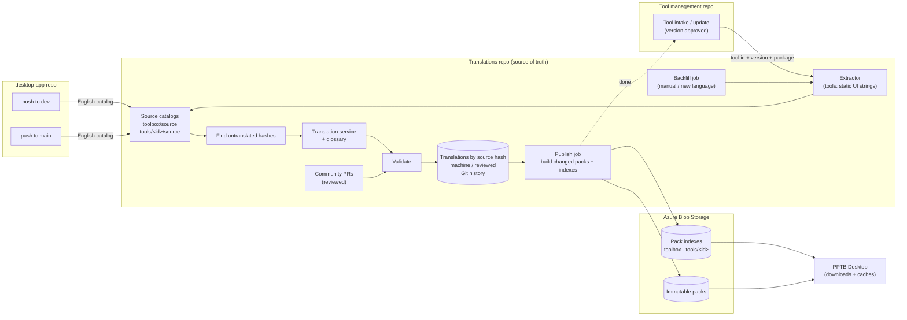
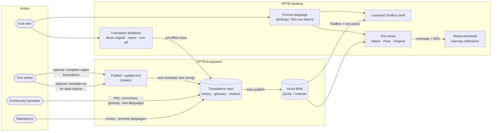
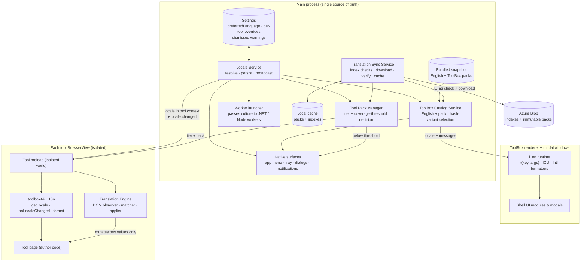
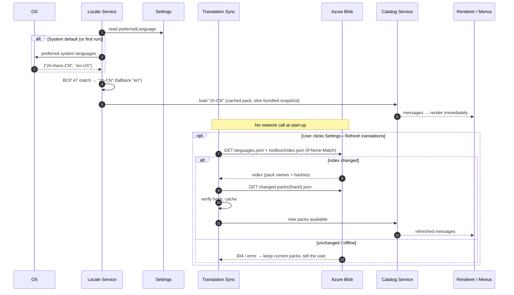
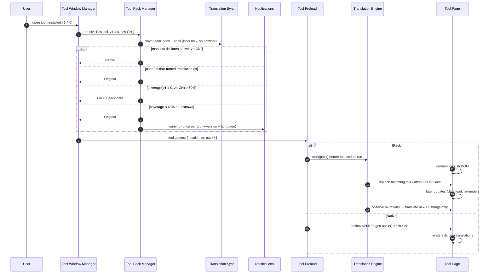
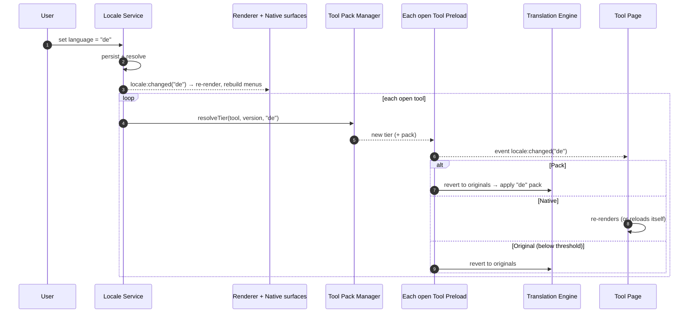
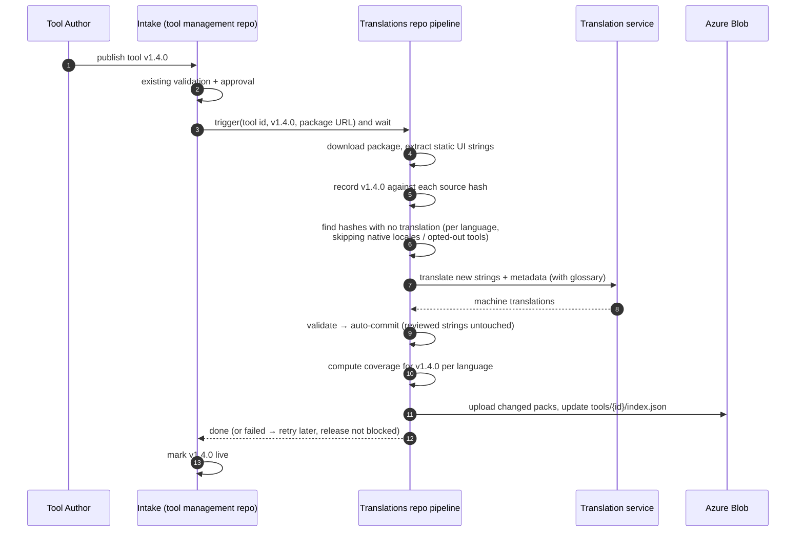
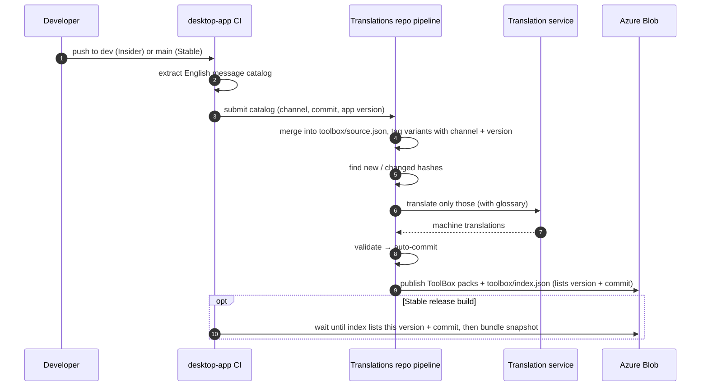
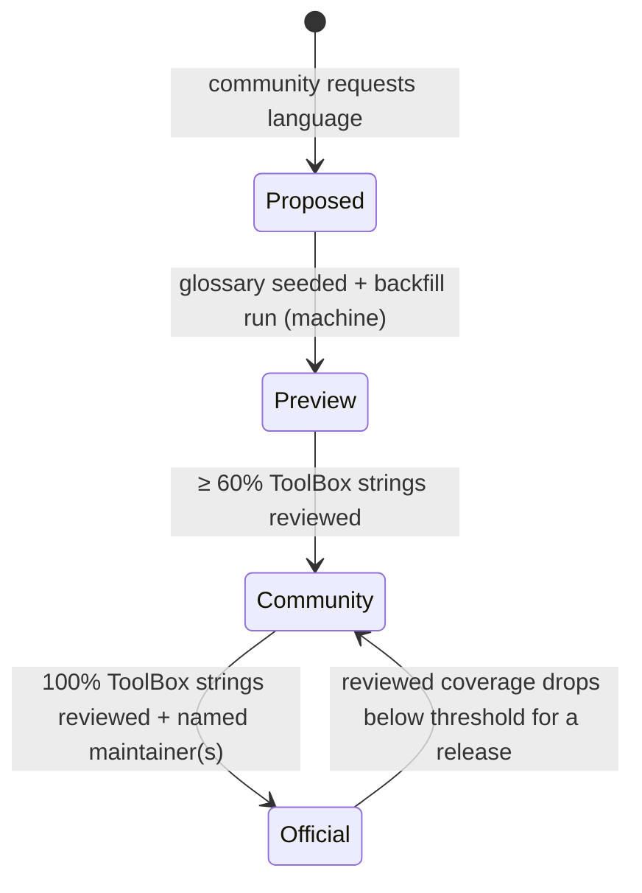

# Localization (i18n) Architecture — ToolBox and Tools

Status: **Design agreed — ready for implementation planning** · Tracking issue: [#705](https://github.com/PowerPlatformToolBox/desktop-app/issues/705)

This document describes how Power Platform ToolBox (PPTB) and the tools it hosts show their interface in the language the user picks. It covers design only. Implementation planning (PR phases, files) will follow in a separate document.

---

## 1. Problem Statement

Issue #705 asks for multi-language support. The first release supports **Chinese (Simplified), Spanish, and Hindi** alongside English (§5.1). Translating only the ToolBox shell does not solve the user's problem: **users spend most of their time inside tools**, and those tools are written by independent authors in English.

We cannot require every tool author to localize their tool. Most will not, and the ones who try will each pick a different approach. The design therefore has to:

1. Localize the ToolBox shell properly.
2. Give tool authors a simple, optional way to localize natively.
3. **Translate tools that do nothing at all**, with no work from the author, without leaking customer data and without breaking the tool.

---

## 2. Guiding Principle — Pre-Packaged, Never Live

> **Nothing is translated while the app runs.** All translation happens in CI. The app only **downloads pre-built translation files** from Azure Blob Storage and applies them. This is true for both the ToolBox and the tools.

Consequences of this principle:

- No UI text or customer data ever leaves the user's machine for translation.
- Translations are reviewable, versioned, and identical for every user.
- The app works fully offline once the files are cached.
- A corrected translation reaches users **without an app or tool release**.

---

## 3. Goals and Non-Goals

### Goals

| #   | Goal                                                                                                                                                                  |
| --- | --------------------------------------------------------------------------------------------------------------------------------------------------------------------- |
| G1  | The user picks a language once in Settings. The ToolBox and every open tool follow it.                                                                                |
| G2  | On first run, the OS language is detected automatically. English is always the fallback.                                                                              |
| G3  | Tools are translated **without author effort** (zero-touch), using pre-built translation packs.                                                                       |
| G4  | Tool authors who want full control can ship their own **complete** translations, and these always take priority.                                                      |
| G5  | **Customer data is never translated or sent anywhere.** Dataverse records, logs, solution names, and user input stay as they are.                                     |
| G6  | Power Platform terminology stays consistent across the ToolBox and all tools (shared glossary, with do-not-translate terms such as _Dataverse_ and _Power Automate_). |
| G7  | All translations live in **one dedicated GitHub repository** with full history. The community contributes through pull requests.                                      |
| G8  | Translations are produced **automatically** whenever the ToolBox (dev or main) or a tool changes, and published to Azure Blob Storage.                                 |
| G9  | The ToolBox's **Insider** (dev) and **Stable** (main) channels share **one** set of translations, and each build shows only translations that match its own English text. |
| G10 | Every supported **tool version** gets translations that match its text.                                                                                               |
| G11 | Switching language at runtime does not require restarting the app.                                                                                                    |

### Non-Goals (for the first release)

- Translating **data** (record values, field display names returned by Dataverse, log output, terminal output).
- Translating **LLM-facing text** such as MCP tool descriptions and schemas. These stay in English because agents work best with them.
- Translating **telemetry, logs, and Sentry events**. These stay in English so support and triage keep working.
- Translating the **CLI**. It is used for scripting and stays in English.
- Full right-to-left (RTL) layout. The design leaves room for it (see §15), but it is not in the first release.
- Supporting **partial** native translations from tool authors (see §13).

---

## 4. Core Concepts

| Concept                     | Meaning                                                                                                                                                                                                                         |
| --------------------------- | ------------------------------------------------------------------------------------------------------------------------------------------------------------------------------------------------------------------------------- |
| **Preferred language**      | What the user picked in Settings: a specific language, or _System default_.                                                                                                                                                     |
| **Effective locale**        | The single BCP 47 tag (for example `zh-CN`) the app actually uses after resolution. It is the same value everywhere in the app.                                                                                                  |
| **Source catalog**          | The English strings to translate. For the ToolBox it is the key-based message catalog (`key → English`). For a tool it is the list of **static UI strings** extracted automatically from that tool version's bundle.          |
| **Source hash**             | A hash of a normalized English string. Translations are stored **against the source hash**, not against a version, so one translation serves every version and channel that uses the same English text.                     |
| **Translation pack**        | A data-only JSON file holding the translations for one target (the ToolBox, or one tool) in one language. Built in CI, stored in Blob, cached by the app.                                                                        |
| **Pack index**              | A small JSON file in Blob per target that lists the current pack for each language and its coverage. The app checks it cheaply (ETag) to see if anything changed.                                                                |
| **Coverage**                | The share of a target's source strings that have a translation in a given language. For tools it is computed **per tool version**.                                                                                              |
| **Coverage threshold**      | **60%.** A tool version below 60% coverage for the user's language is not translated, and the user gets a notification explaining why.                                                                                          |
| **Translation status**      | Each translated string is either **machine** (from the translation service) or **reviewed** (approved by a human). Reviewed strings are never overwritten by machine output.                                                    |
| **Translation tiers**       | Where a tool's translation comes from: **Native** (the author's own, complete), **Pack** (from the translations repo), or **Original** (English).                                                                              |
| **Glossary**                | A shared terminology list per language: preferred translations and do-not-translate terms. Fed to the translation service and used by reviewers.                                                                              |
| **Protected region**        | Part of a tool's page that must never be translated. Marked by the HTML-standard `translate="no"` attribute, by a PPTB attribute, or detected by heuristics (inputs, editable content, code blocks, and so on).                |
| **Channel**                 | The ToolBox release line: **Insider** (built from `dev`) or **Stable** (built from `main`). Both share one set of translations; the channel is only a tag (§7).                                                                 |

---

## 5. How It Works — The Process

### 5.1 Choosing a language

#### Initial languages

| Language shown to the user | Native name | Internal code | Matched from OS languages                      |
| -------------------------- | ----------- | ------------- | ---------------------------------------------- |
| English                    | English     | `en`          | any `en-*`; also the fallback for everything   |
| Chinese (Simplified)       | 简体中文    | `zh-CN`       | `zh-CN`, `zh-Hans-*`, `zh-SG`                  |
| Spanish                    | Español     | `es`          | any `es-*` (one neutral Spanish for all regions) |
| Hindi                      | हिन्दी      | `hi`          | `hi`, `hi-IN`                                  |

- Chinese is labelled **"Chinese (Simplified)"** so that **"Chinese (Traditional)"** can be added later without renaming anything. Traditional Chinese OS settings (`zh-TW`, `zh-HK`, `zh-Hant-*`) are **not** matched to Simplified; they fall back to English and the user can choose Simplified manually.
- More languages are added through the language lifecycle (§16) without an app release.

#### Steps

1. **First run:** the ToolBox reads the OS's preferred languages and matches them against the supported languages using the table above. If nothing matches, it uses English.
2. **Settings:** the user picks _System default_ or a language **by name**, for example _Spanish_. **Language codes are never shown to users.** Each entry shows:
   - the language name in the **current UI language** (for example _Spanish_ in an English UI, _Español_ in a Spanish UI);
   - the **native name** as a second line, so a user who switched to a language they can't read can still find their way back (_Hindi · हिन्दी_);
   - its quality level: **Official**, **Community**, or **Preview** (see §16).
3. The choice is saved with the other user settings and survives updates.
4. The **effective locale** (the internal code) is resolved once in the main process, which is the only place that holds this value. Every other part of the app (renderer, modal windows, notifications, tray, tool views, workers) receives it from there. Codes only appear in developer-facing places: the tool manifest, the API, and troubleshooting exports.

### 5.2 How and when translations reach the app

Translations are downloaded **only when an update happens or the user asks**. The app makes **no translation network calls** at start-up, on a timer, when a tool opens, or in the background. This keeps start-up and tool launch fast and puts no load on background workers.

- Each ToolBox build ships with **English plus the ToolBox packs for every supported language and `languages.json`**. Both Insider and Stable builds wait for their own version's translations before bundling (§6.5 A), so a fresh build is complete without any download.
- When a tool is installed or updated, the app downloads that tool's index and its packs for **every supported language** (excluding the tool's native languages). Packs are text-only and small, so switching language later never needs the network.
- Every download is verified against the hash in its index and saved to the local cache. Requests are conditional (ETag), so a refresh where nothing changed is a tiny "not modified" response.
- If a download fails (offline, Blob unreachable, corrupt file), the app keeps the last good cached or bundled pack and tells the user the refresh failed. If it has nothing, it shows English. It never shows blank text or raw keys.

#### When the ToolBox's translations are updated

| Trigger                                                    | What happens                                                                                          | When the new text appears                                         |
| ---------------------------------------------------------- | ----------------------------------------------------------------------------------------------------- | ----------------------------------------------------------------- |
| **App update**                                             | The new build includes the latest ToolBox packs and `languages.json`. No network call.               | On first launch of the new version                                |
| **"Refresh translations"** in Settings › Language (on demand) | Checks `languages.json` and the ToolBox index; downloads any changed packs                          | Right away: the shell re-renders in place, as for a language change |
| **Language change**                                        | Nothing to download: every language is already bundled                                               | Right away                                                        |

#### When a tool's translations are updated

| Trigger                                                                 | What happens                                                                                           | When the new text appears                                                       |
| ----------------------------------------------------------------------- | ------------------------------------------------------------------------------------------------------ | ------------------------------------------------------------------------------- |
| **Tool install or update**                                              | Downloads the tool's index and its packs for every supported language                                  | The first time the tool opens                                                   |
| **"Refresh translations"** on the installed tool's card (context menu, on demand) | Checks that tool's index; downloads any changed packs                                         | Right away. If the tool is open, it is re-translated in place.                  |
| **Language change**                                                     | Nothing to download: packs for every language were saved at install or update                         | Open tools: right away (re-translated in place, §5.7). Other tools: when they open. |
| **Tool open**                                                           | **No network call.** Uses the saved packs and coverage.                                                | —                                                                               |

**Marketplace text** (translated descriptions, categories, tags) is fetched together with the marketplace's existing tool-list request, so it adds no new trigger.

#### How quickly a change reaches users

| Change                                                     | Reaches users                                                                                                                                                                 |
| ---------------------------------------------------------- | ----------------------------------------------------------------------------------------------------------------------------------------------------------------------------- |
| **New tool version**                                       | Translations are published during intake, **before** the version goes live, so they are downloaded with the tool on install or update.                                       |
| **New or changed ToolBox strings** (push to `dev` or `main`) | Included in the next build of that channel: the nightly Insider build, or the next Stable release.                                                                         |
| **Correction merged in the translations repo**             | ToolBox: the next app update (Insider nightly, Stable at each release), or sooner with Settings › Refresh translations. Tool: the next tool update, or sooner with the card's Refresh translations. |
| **New language**                                           | Appears in the language picker after the next app update, or after Settings › Refresh translations.                                                                          |

**Trade-off accepted:** a correction to a tool that doesn't get updated reaches users only when they refresh it. That is the price of no background network activity. The below-threshold notification (§5.5) and the "translated" indicator (§5.8) both point users to the refresh option.

### 5.3 The ToolBox shell is localized

- Every user-visible string in the ToolBox (menus, sidebar, settings, modals, notifications, dialogs, tray menu, error messages) goes through a **message key** instead of hard-coded English.
- Messages use **ICU MessageFormat**, so plurals and placeholders work correctly in every language. For example: `{count, plural, one {# tool updated} other {# tools updated}}`.
- If a key has no translation in the chosen language, that key alone **falls back to English**.
- Dates, numbers, and relative times are formatted with the platform's `Intl` APIs using the effective locale. They are never hard-coded to `en-US`.
- Error messages show a translated message plus a **stable English error code** (for example `PPTB-CONN-004`), so users can search for it and support can recognize it.

### 5.4 Tools are localized (layered)

When a tool opens, the ToolBox decides **per tool, per version, and per language** which tier applies:

```
Native (author ships complete translations)  >  Pack (coverage ≥ 60%)  >  Original (English)
```

- **Native:** the tool declares in its manifest that it supports the effective locale. The ToolBox passes the locale to the tool and **does not interfere**. The automatic engine stays off for that tool.
- **Pack:** the tool does not support the locale natively, and the pack covers **at least 60%** of this tool version's strings. The **Translation Engine** inside the tool's view replaces matching UI strings as the page renders.
- **Original:** the tool is shown in English. This happens when:
  - coverage is **below 60%**, or coverage is unknown because the version has no translation data yet. The user gets a **warning notification** explaining why (see §5.5);
  - the user turned translation off for this tool;
  - the author opted out of automatic translation;
  - the tool is a local development tool loaded from disk (no notification is shown, because the tool is not from the registry).

### 5.5 Below-threshold notification

When a tool is shown in English because coverage is too low, the user sees a non-blocking warning notification, for example:

> **Data Explorer is shown in English.** Only 42% of its text has been translated into 简体中文, which is below the minimum needed for a usable translation. _Help translate · Don't show again for this tool_

- It is shown **once per tool, version, and language**, not every time the tool opens.
- _Help translate_ opens the translations repo's contribution guide for that tool and language.
- When coverage is unknown (no translation data for this version yet), the message says the translation is still being prepared and suggests **Refresh translations** on the tool's card later. The app doesn't retry on its own.

### 5.6 How zero-touch translation stays safe

1. **Only static strings are translated.** In CI, the tool's bundle is scanned for static UI strings: button labels, headings, `placeholder`, `title`, `aria-label`, and string or template literals used as UI text. Only these are sent to the translation service.
2. **Only what is in the pack is replaced at runtime.** The engine replaces text **only if it exactly matches** (after normalization) a pack entry or pattern. Data loaded from Dataverse is not in the pack, so it is never touched.
3. **Protected regions are skipped:** `translate="no"`, inputs, textareas, editable content, code and pre blocks, and anything the author marks as data.

Templated strings such as `` `Found ${n} records` `` are captured as **patterns** with placeholders (`Found {0} records`). The engine matches the pattern, translates the fixed parts, and leaves the placeholder value exactly as it is.

### 5.7 Switching language at runtime

1. The user picks a new language in Settings.
2. The main process resolves the new effective locale, loads the matching packs from the local cache or the bundled snapshot (no download is needed, §5.2), and broadcasts the change.
3. The ToolBox shell re-renders its strings. Native menus and the tray menu are rebuilt.
4. Each open tool gets a `locale:changed` event, and its tier is worked out again for the new language:
   - **Native** tools handle it themselves (re-render or reload).
   - **Pack** tools are re-translated in place: the engine restores the original text, then applies the new pack.
   - Tools that fall below the threshold in the new language revert to English and show the notification.
5. Nothing restarts, and connections and tool state are kept.

### 5.8 Improving translations over time

1. A small "translated" indicator on the tool tab offers four actions: **Show original**, **Refresh translations**, **Report a bad translation**, and **Turn off for this tool**. The installed tool's card has the same **Refresh translations** option in its context menu.
2. _Report a bad translation_ opens a pre-filled issue in the translations repo. It contains the tool, version, language, English string, and current translation. It never includes surrounding page content.
3. Community pull requests correct entries. A corrected entry becomes **reviewed** and is never overwritten by machine output again.
4. Every merge to the translations repo republishes the affected packs to Blob automatically (§6.6), so users get the fix on their next index check.

---

## 6. Translation Supply Chain

This section describes where translations are stored, how they are produced, and how they reach Blob.

### 6.1 Repositories and their roles

| Repository                                   | Role in localization                                                                                                                                                                                                           |
| -------------------------------------------- | ------------------------------------------------------------------------------------------------------------------------------------------------------------------------------------------------------------------------------ |
| **desktop-app**                              | Owns the ToolBox's English message catalog. On push to `dev` or `main`, CI extracts the catalog and submits it to the translations repo, tagged with its channel.                                                              |
| **Tool management repo** (intake & updates)  | Owns tool intake and update automation. When a tool version is approved, intake **triggers the translation job and waits for it**, so the tool version and its translations go live together.                                  |
| **Translations repo** (new, e.g. `pptb-translations`) | **Single source of truth and history** for all translations, the glossary, and the language list. It is the **only** place that calls the translation service and the **only** place that publishes to Blob. |
| **Azure Blob Storage**                       | Delivery. Holds immutable packs and the pack indexes the app reads. Nothing is edited here by hand.                                                                                                                            |

Centralizing extraction, translation, and publishing in the translations repo means the translation service credentials live in one place. It also means ToolBox updates, tool intake, and the one-time backfill all run **the same pipeline**.

### 6.2 Translations repo layout (conceptual)

```
languages.json                   supported languages, status, maintainers
glossary/<lang>.json             preferred terms + do-not-translate list
toolbox/
  source.json                    English catalog from desktop-app, both channels; each variant tagged
                                 with the channels + app versions it appears in (generated, never hand-edited)
  <lang>.json                    translations keyed by source hash, each marked machine / reviewed
tools/<tool-id>/
  source.json                    extracted English strings keyed by source hash,
                                 with the tool versions each string appears in
  <lang>.json                    translations keyed by source hash, each marked machine / reviewed
  metadata.<lang>.json           translated marketplace text (short description, categories, tags)
```

The repo's Git history is the audit trail: who changed which translation, when, and why.

### 6.3 Why translations are stored by source hash

Translations are **not** stored per app version, per channel, or per tool version. They are stored once per distinct English string (its source hash).

- When the same English text appears in Insider and Stable, or in tool v1.3 and v1.4, it is **translated once and reviewed once**.
- When the English text changes, its hash changes, so a new translation is produced. A translation written for old wording is **never shown** next to new wording.
- Versions and channel tags only decide **which hashes go into a pack**. They never duplicate translations.

### 6.4 Merge policy

- **Machine translations are merged automatically.** The pipeline's bot commits them directly to the translations repo. Users get translated tools as soon as a version is published.
- **Reviewed translations are protected.** The pipeline never overwrites a string marked _reviewed_.
- **Human changes go through pull requests**, reviewed by that language's maintainers. Merging a change marks the string _reviewed_.
- **Validation gates every commit**, automated or human: placeholders preserved, no markup, do-not-translate terms intact, valid JSON. A failing commit is not published.

### 6.5 Pipelines

There are four triggers. All of them end in the same publish step.

#### A. ToolBox change — push to desktop-app `dev` or `main`

1. desktop-app CI extracts the English message catalog.
2. It submits the catalog to the translations repo, stating the channel (`insider` for `dev`, `stable` for `main`), the commit, and the app version.
3. The translations repo merges it into the single `toolbox/source.json`. Each English variant of each key is tagged with the channels and app versions it appears in.
4. It finds the new or changed hashes and translates **only those**, using the translation service and the glossary. Unchanged strings reuse their existing translations.
5. It validates, commits automatically, and publishes the ToolBox packs and index (§6.6). The index records the app version and commit it now covers.
6. **Both Insider (nightly) and Stable release builds** wait, with a timeout, until the index lists their app version and commit before bundling the snapshot. Because the app doesn't download ToolBox translations by itself (§5.2), the bundled snapshot is what users get, so every build must ship fully translated.

#### B. Tool intake or update — tool management repo

1. A tool version is approved by the existing intake or update process.
2. Intake triggers the translations repo with the tool ID, version, and package location, and **waits for the result**.
3. The translations repo downloads the package and extracts its static strings. It records the version against each string's hash in `tools/<tool-id>/source.json`.
4. It translates only hashes that have no translation yet (per language), plus the marketplace metadata.
5. It computes **coverage for this version** per language, validates, commits automatically, and publishes the tool's packs and index (§6.6).
6. Intake marks the version live. Translation failure does **not** block the tool release: the version goes live, the app shows English with the "still being prepared" notification, and the nightly reconciliation run (pipeline C) picks the version up.
7. Tools with `autoTranslate: false`, and locales the tool supports natively, are skipped.

#### C. Backfill — translate all existing tools

A job in the translations repo with two modes:

- **Full** (manual): the one-time translation of all existing tools, also used when a **new language is added**.
- **Missing only** (nightly, scheduled): **reconciliation**. It finds registry tool versions with no translation data, for example because pipeline B failed or timed out, and processes only those.

1. List every tool in the public registry index in Blob, with its latest version and the versions still within the retention window (§8).
2. Run pipeline B's extract, translate, and publish steps for each one.
3. It is **idempotent**: strings that already have a translation are skipped, so re-running only does new work. It never overwrites reviewed strings.
4. It processes tools in batches with a rate limit on the translation service, and can resume where it stopped.

#### D. Translations repo change — publish to Blob

Runs on every push to the translations repo's main branch, whether from pipelines A–C or from a merged community PR.

1. Validate all changed files.
2. Find the packs affected by the change (ToolBox, tools, languages).
3. Rebuild only those packs. Upload each pack to Blob under a **content-based name**; packs are immutable once uploaded.
4. Update the pack index for each affected target to point at the new packs, with new coverage figures.
5. Rollback means pointing the index back at the previous pack.

### 6.6 Supply-chain diagram



### 6.7 Blob layout (conceptual)

```
translations/
  languages.json                       supported languages + status (read by Settings)
  toolbox/index.json                   current pack per language + the app versions it covers (both channels)
  tools/<tool-id>/index.json           current pack per language + coverage per tool version
  marketplace/<lang>.json              translated marketplace text for all tools (one fetch)
  packs/<content-hash>.json            immutable pack files
```

---

## 7. ToolBox Channels — One Shared Translation Set

Insider (built from `dev`) and Stable (built from `main`) use **the same ToolBox translations**: one source file in the translations repo, and one index and one pack per language in Blob. This is the same model as tools (§8), where one pack serves every version.

### 7.1 How one set serves both channels and older builds

- A ToolBox pack can hold **more than one translation for a key**, one per English variant (source hash). This covers a key whose English differs between `dev` and `main`, or between releases.
- Every build picks the variant whose hash matches the English text **it shipped with**. Keys a build doesn't have (for example Insider-only keys in a Stable build) are simply never looked up. If no variant matches, that key falls back to English, so a build never shows a translation written for different wording.
- When a feature moves from `dev` to `main`, its strings are **already translated** (same English, same hash), so Stable gets them at no extra cost.
- A correction to a string both channels share reaches **both** at once.

### 7.2 What the channel is still used for

The channel is a **tag**, not a separate set of files:

- **Retention:** an English variant stays in the pack while it is used by the current `dev` catalog or by any of the **last three Stable releases**. This is counted in Stable releases rather than app versions because Insider ships nightly, so "last N versions" would only cover a few days.
- **Release gating:** the index lists the app versions and commits it covers, so a Stable release build can wait until its own version is translated (§6.5 A).
- **Review priority:** reviewers can filter to strings that are in Stable, so released UI gets reviewed first.
- **Coverage reporting:** coverage is reported per channel and app version.

### 7.3 Trade-off accepted

With one set, a publish triggered by a push to `dev` rebuilds the pack that Stable users download. A pipeline bug triggered by churn on `dev` could therefore reach Stable users. Tools already accept the same risk (one tool update rebuilds the pack every version uses). It is limited by:

- validation on every commit;
- packs that are never overwritten once published;
- rollback by pointing the index back at the previous pack.

---

## 8. Tool Versions

Each tool has **one pack per language** covering the strings of **all its supported versions**, rather than a separate pack for each version.

- The engine only replaces text that exactly matches the pack, so strings from other versions are harmless.
- **Every supported version is covered** by the same pack, including older versions users still have installed.
- **Corrections apply to all versions** immediately, and nothing is stored twice.
- **Coverage is tracked per version** in the tool's pack index (for example `1.3.0 → 95%`, `1.4.0 → 88%`). The app uses the coverage of the **installed** version to apply the 60% threshold.
- **Retention:** the pack keeps strings used by the **latest five versions** of the tool (configurable). Strings used only by older versions are removed from the pack, but their translations stay in the translations repo and come back automatically if the text appears again.
- **A version with no translation data** (pipeline failed, or not processed yet) has unknown coverage. It is treated as below threshold: the tool shows in English with the "still being prepared" notification. Because translation runs during intake, this should be rare. Once nightly reconciliation has published the data, the user gets it with the card's **Refresh translations** or the next tool update.
- **A version older than the retention window** may fall below 60% coverage as strings are pruned, and then shows in English with the notification. Users can fix this by updating the tool.

---

## 9. Functional Architecture

What each actor does and what they see.



### 9.1 Functional capabilities by actor

| Actor                    | Capability                                                                                                                                                                         |
| ------------------------ | ---------------------------------------------------------------------------------------------------------------------------------------------------------------------------------- |
| **End user**             | Pick a language or System default · see each language's quality level · switch without restarting · per-tool _Show original_ / _Turn off_ · _Refresh translations_ (Settings for the ToolBox, tool card for a tool) · report bad translations · see why a tool was not translated. |
| **Tool author (none)**   | Nothing is required. The tool is translated automatically when it is published.                                                                                                     |
| **Tool author (light)**  | Mark data areas with `translate="no"` to improve accuracy · read the effective locale for formatting.                                                                               |
| **Tool author (full)**   | Ship **complete** native translations for chosen locales, declare them in the manifest, and react to `locale:changed`.                                                             |
| **Community translator** | Correct machine translations · translate the ToolBox · maintain the glossary · propose new languages, all through PRs to the translations repo.                                   |
| **Maintainers**          | Approve languages and promote them from Preview to Community to Official · own the glossary · review PRs · track coverage.                                                         |

---

## 10. Technical Architecture

### 10.1 Component view



### 10.2 Component responsibilities

| Component                    | Lives in                      | Responsibility                                                                                                                                                                                                                                                                                                    |
| ---------------------------- | ----------------------------- | ----------------------------------------------------------------------------------------------------------------------------------------------------------------------------------------------------------------------------------------------------------------------------------------------------------------- |
| **Locale Service**           | Main                          | Resolves the effective locale (user choice → OS → `en`) using BCP 47 matching. Persists the preference. Broadcasts changes to every window and tool view. The **only** place locale is decided.                                                                                                                   |
| **Translation Sync Service** | Main                          | The only component that talks to Blob for translations. Makes network calls **only** on tool install or update and on the user's Refresh translations actions (Settings for the ToolBox, the tool card for a tool). Never at start-up, on a timer, or on tool open. Uses ETag conditional requests. Downloads packs, verifies them against the index hash, caches them on disk, and keeps the last good copy. Never sends any text to the network.               |
| **ToolBox Catalog Service**  | Main                          | Merges English with the best available pack (cached, or the bundled snapshot). Picks the hash variant that matches the build's English text. Serves messages to the renderer, modal windows, and main-process surfaces.                                                                                         |
| **i18n runtime**             | Renderer & modals             | Lightweight `t(key, args)` with ICU MessageFormat, plus locale-aware `Intl` formatters. Sets `lang` (and later `dir`) on the document. Re-renders when the locale changes.                                                                                                                                         |
| **Tool Pack Manager**        | Main                          | Decides the tier per tool, installed version, and locale: native locales from the manifest, coverage from the tool's index, the 60% threshold, user overrides, and author opt-out. Raises the below-threshold notification, once per tool, version, and language.                                                |
| **toolboxAPI.i18n**          | Tool preload                  | Public API for tools: `getLocale()`, `onLocaleChanged()`, and `format` helpers for dates and numbers. Locale is also added to `ToolContext`.                                                                                                                                                                         |
| **Translation Engine**       | Tool preload (isolated world) | Applies a pack to the tool's DOM: walks text nodes and the translatable attributes, observes mutations, matches against the pack, applies the translation, remembers the original, and supports re-translate and revert. Runs **before** tool scripts so the user doesn't see English first.                     |
| **Native surfaces**          | Main                          | App menu, tray, OS dialogs, OS notifications. These are rebuilt when the locale changes.                                                                                                                                                                                                                           |
| **Worker launcher**          | Main                          | Passes the effective locale to .NET and Node workers (as a culture or environment variable) so number and date handling matches.                                                                                                                                                                                  |

### 10.3 Why the engine runs in the preload's isolated world

- The tool's own code **cannot see or tamper with** the engine, its packs, or the original strings.
- The engine has full DOM access but **only ever changes the value of an existing text node or attribute**. It never wraps, replaces, or inserts elements. This avoids the well-known problem where browser translation breaks React and other virtual-DOM frameworks (they crash when nodes they manage are replaced).
- Translations are written as **plain text**, never as HTML, so a broken or malicious pack cannot inject markup or script.

---

## 11. Key Flows (Sequence Diagrams)

### 11.1 Startup and locale resolution



### 11.2 Opening a tool



### 11.3 Changing language at runtime



### 11.4 Tool intake / update → translation



### 11.5 desktop-app push → ToolBox translation



---

## 12. Translation Engine — Design Details

### 12.1 What the engine translates

| Translated                                                                     | Never translated                                                                                     |
| ------------------------------------------------------------------------------ | ---------------------------------------------------------------------------------------------------- |
| Text nodes whose normalized text matches a pack entry or pattern               | Anything not in the pack (that is, runtime data)                                                     |
| Attributes: `placeholder`, `title`, `aria-label`, `alt`, `value` on buttons    | `input`/`textarea` values, `contenteditable`, `code`/`pre`, `script`/`style`                         |
| `document.title`                                                               | Elements under `translate="no"` or the PPTB no-translate marker                                      |
|                                                                                | Text inside known data hosts (grid cells, Monaco and other editors) unless the author opts in        |

### 12.2 Matching strategy

1. **Normalize** the text: trim, collapse whitespace, normalize Unicode.
2. **Exact lookup** in the pack's map (O(1)).
3. **Pattern lookup** for templated strings. Patterns are compiled once per pack into an efficient matcher. Captured values are put back into the translated pattern **unchanged**.
4. **Original-text memory:** the engine stores the original for each node it changes, so it can _Show original_, revert, and re-translate when the language changes. If the tool's framework later writes English back into the node (a re-render), the observer catches it and re-applies the translation.

### 12.3 Performance and user experience

- The engine starts **at document start**, so there is no visible flash of English. The first pass runs before first paint where possible, with a short safety timeout so a slow pass never blocks the tool.
- Mutation handling is **batched per animation frame**, so large grids and lists are processed together rather than node by node.
- Packs are small (text only) and cached on disk. Language switches need no network when the pack is already cached.
- **Budget guard:** if a page mutates heavily (for example a live log view), the engine throttles itself and skips subtrees that keep changing.

### 12.4 Extraction (CI side)

- The extractor finds static UI strings in the tool's **published bundle**, using heuristics for minified JavaScript. Authors do not need to provide source maps or string manifests.
- Strings that don't look like UI text are skipped: URLs, identifiers, CSS class names, OData queries, GUIDs, and very short or symbol-only strings.
- The extractor is shared by intake (pipeline B) and backfill (pipeline C), so every tool goes through the same logic.

---

## 13. Tool Author Contract

The contract adds to the manifest and API **without breaking anything**. Existing tools need no changes.

### 13.1 Two independent ways a tool gets translated

| | **Automatic (packs)** | **Native** |
| --- | --- | --- |
| Who translates | PPTB pipeline, from the tool's published bundle | The tool author |
| What the author supplies | Nothing | Complete translated resource files, plus the code that uses them |
| Who renders the translated text | PPTB's Translation Engine, which swaps text in the tool's page | The tool's own code |
| When it is used | For every language the author **hasn't** declared as native | Only for the languages the author declares |

The two can be mixed. For example, a tool can ship native Spanish while Chinese and Hindi users get automatic packs.

### 13.2 What a native author supplies

A native tool works like any localized web app:

1. **Resource files** in the tool package: one JSON file per language, mapping the tool's own keys to text. `en.json` is the reference and is required.

    ```
    locales/en.json   { "save.button": "Save changes", "records.found": "Found {count} records" }
    locales/es.json   { "save.button": "Guardar cambios", "records.found": "Se encontraron {count} registros" }
    ```

2. **Code that renders them:** the tool reads the effective locale from `toolboxAPI.i18n.getLocale()`, loads the matching file with whatever i18n library it likes, and re-renders on `locale:changed`.
3. **A manifest declaration** naming those languages, so PPTB knows to stay out of the way:

    ```json
    {
        "features": {
            "localization": {
                "native": ["en", "es"],
                "resources": "locales",
                "autoTranslate": true
            }
        }
    }
    ```

- `native`: the languages the tool translates **itself**, using internal codes (developer-facing only). For these languages the engine is **off** and no pack is generated.
- `resources`: the folder in the package holding the JSON files. Nested JSON is allowed; keys are compared in flattened form (`save.button`).
- `autoTranslate`: defaults to `true`. Setting it to `false` turns off automatic packs for all non-native languages (for example a tool that is mostly a code editor).

A native author does **not** supply a list of strings for PPTB's extractor. That string list was a possible way to help **automatic** translation find strings, and it has been dropped: the extractor works from the bundle alone (§12.4). Native authors supply their **translations**; tools without native translations supply nothing.

### 13.3 Native translations must be complete

To keep things simple, **partial native translations are not supported.**

- Every language listed in `native` must have a resource file containing **every key** in `en.json`, with a non-empty value. Placeholders must match `en.json` (for example `{count}`).
- The shared validation package checks this during intake. A tool that declares a native locale with missing keys **fails validation**, and the error lists the missing keys.
- A tool can drop a locale from `native` instead. That locale is then covered by packs like any other tool.

### 13.4 Runtime API (optional)

| API                                   | Purpose                                              |
| ------------------------------------- | ---------------------------------------------------- |
| `toolContext.locale`                  | Effective locale, available at launch.               |
| `toolboxAPI.i18n.getLocale()`         | Current effective locale.                            |
| `toolboxAPI.i18n.onLocaleChanged(cb)` | Also delivered as a `locale:changed` ToolBox event.  |
| `toolboxAPI.i18n.format.*`            | Locale-aware date, number, and relative-time helpers. |

Tools with native translations use whatever i18n library they prefer, and read the locale from the API.

### 13.5 Author guidance (the "light" path)

- Put `translate="no"` on containers that show **data** (grids, record details, logs). This is a standard HTML attribute.
- Avoid building sentences by concatenating strings. Use template literals, which the extractor turns into patterns.
- Keep UI text in the bundle rather than fetching it at runtime, so the extractor can find it.

---

## 14. ToolBox Shell Localization Details

| Area                       | Approach                                                                                                                                                                                       |
| -------------------------- | ---------------------------------------------------------------------------------------------------------------------------------------------------------------------------------------------- |
| **Catalog structure**      | One English source catalog, split into namespaces by feature area (common, settings, marketplace, connections, modals, notifications, errors, menus). Translations come from the ToolBox packs. |
| **Message format**         | ICU MessageFormat: plurals, select, and named placeholders. No concatenation in code.                                                                                                          |
| **Modals & notifications** | Modal and notification windows are separate browser windows. They get the locale and messages from the main process, the same way they already get the theme.                                 |
| **Main-process strings**   | Menus, tray, OS dialogs, and protocol-handler prompts use the same catalog.                                                                                                                    |
| **Marketplace content**    | Tool names stay as they are (they are brand names). Short descriptions, categories, and tags are translated by pipeline B and served from one marketplace file per language. If a translation is missing, English is shown. |
| **Formatting**             | All dates, numbers, file sizes, and relative times go through locale-aware formatters.                                                                                                         |
| **Fonts**                  | The theme defines per-language font fallback chains. **Chinese:** Microsoft YaHei / PingFang SC / Noto Sans CJK SC. **Hindi (Devanagari):** Nirmala UI / Kohinoor Devanagari / Noto Sans Devanagari. Spanish uses the existing Latin fonts. Rendering is checked on Windows, macOS, and Linux. |
| **Text length**            | Spanish UI text is typically 20–30% longer than English and Hindi can be taller (Devanagari marks above and below the line). Layouts must wrap or truncate cleanly; the pseudo-locale (§14.1) finds problems early. |

### 14.1 Quality gates

| Gate                  | Where              | Check                                                                                                                       |
| --------------------- | ------------------ | --------------------------------------------------------------------------------------------------------------------------- |
| **No hard-coded UI**  | desktop-app CI     | A lint rule flags user-visible string literals that don't go through a message key.                                          |
| **Pseudo-locale**     | desktop-app        | A built-in test locale (for example `en-XA`, which accents and lengthens every string by about 35%) shows hard-coded strings and layouts that break with longer text. |
| **Placeholders**      | Translations repo  | Each translation contains exactly the same ICU placeholders or pattern slots as the English source.                         |
| **Glossary**          | Translations repo  | Do-not-translate terms appear unchanged.                                                                                     |
| **Coverage report**   | Translations repo  | Coverage per language for the ToolBox and per tool version is published with every run.                                     |
| **Native complete**   | Tool intake        | Declared native languages contain every key (§13.3).                                                                         |

---

## 15. Cross-Cutting Concerns

| Concern              | Design decision                                                                                                                                                                                                         |
| -------------------- | ----------------------------------------------------------------------------------------------------------------------------------------------------------------------------------------------------------------------- |
| **Privacy**          | No runtime translation. The translation service only ever sees strings extracted from **public** tool packages and the ToolBox's own catalog. Feedback reports contain only the source string and its translation.   |
| **Security**         | Packs are data-only, immutable, and verified against the index hash. They are applied as plain text. The engine runs in an isolated world the tool cannot reach. Packs never affect CSP or permissions. Only the translations repo's publish job can write to Blob. |
| **Credentials**      | The translation service key and Blob write credentials live only in the translations repo. desktop-app and the tool management repo trigger it but hold no translation secrets.                                      |
| **Telemetry & logs** | Always English. The effective locale and tool tier are recorded as properties (with consent) to measure adoption and coverage.                                                                                          |
| **Support**          | Error codes stay in English. The About dialog and troubleshooting export include the effective locale, pack versions, and per-tool tier.                                                                               |
| **Accessibility**    | `lang` is set on each document so screen readers pronounce text correctly. `aria-label`s are translated.                                                                                                                |
| **RTL (future)**     | The Locale Service exposes text direction. The shell uses CSS logical properties so that flipping `dir` is enough later. RTL for tools is up to the author; the engine only sets `lang`/`dir`.                          |
| **Offline**          | The bundled snapshot covers the ToolBox. Tool packs are cached at install or update. Running fully offline keeps working with the last good packs.                                                                     |
| **Inter-tool / MCP** | Data passed between tools and the MCP surface is never translated. A tool launched headlessly by MCP skips the engine, because there is no UI to translate.                                                             |
| **Cost**             | Translation runs once per **distinct English string** per language, not per version, user, or page view. Backfill and new languages are the only large runs.                                                          |

---

## 16. Language Lifecycle and Governance



- The **supported language list** (tag, native name, status, maintainers) lives in the translations repo and is published to Blob, so a new language appears in Settings **without an app release**.
- Adding a language means: add it to the list, seed its glossary, and run the backfill (pipeline C) for the ToolBox and all tools.
- **Chinese (Simplified), Spanish, and Hindi** start at _Preview_ (fully machine-translated through the backfill) and are targeted at _Official_.
- A hosted translation platform (for example Crowdin or Weblate) can be added later without changing the architecture, because it only syncs files in the translations repo.

---

## 17. Suggested Rollout

| Phase | Scope                                                                                                                                                                                        | Outcome                                                       |
| ----- | -------------------------------------------------------------------------------------------------------------------------------------------------------------------------------------------- | ------------------------------------------------------------- |
| **1** | Translations repo, glossary, language list · pipelines A and D · Blob layout · Locale Service, Translation Sync, Catalog Service, i18n runtime, bundled snapshot · ToolBox shell on Insider. English, Chinese (Simplified), Spanish, Hindi. | ToolBox shell localized on Insider; supply chain proven.      |
| **2** | Shell localization promoted to Stable · quality gates · pseudo-locale.                                                                                                                      | ToolBox shell localized for everyone.                         |
| **3** | Tool author contract: `ToolContext.locale`, `toolboxAPI.i18n`, `locale:changed`, manifest `localization` + complete-translation validation.                                                 | Tools *can* localize natively.                                |
| **4** | Extractor · pipeline B in intake · backfill (pipeline C) · marketplace text translation.                                                                                                    | Packs exist for every marketplace tool.                       |
| **5** | Translation Engine · Tool Pack Manager with the 60% threshold and notification · tab indicator with Show original / Refresh / Turn off / Report · Refresh translations on the installed tool card. Behind the existing **preview feature** flag mechanism at first. | **Zero-touch translation of tools.**                          |
| **6** | Community review workflow, language promotion, coverage dashboards, additional languages.                                                                                                  | Quality improves over time; more languages.                   |

---

## 18. Decisions

| #   | Decision                                                                                                                                                | Section   |
| --- | ------------------------------------------------------------------------------------------------------------------------------------------------------- | --------- |
| D1  | No live translation. The app only downloads pre-built packs, for both the ToolBox and tools.                                                           | §2, §5.2  |
| D2  | All translations live in a dedicated GitHub translations repo with full history. It alone publishes to Azure Blob Storage.                              | §6        |
| D3  | Machine translations are **merged automatically**. Reviewed translations are never overwritten.                                                         | §6.4      |
| D4  | Machine translation is expected to use a **translation service** that supports a custom glossary (for example Azure AI Translator). The pipeline calls it through a provider interface, so the choice can change without affecting the design. | §6.5      |
| D5  | Tool translation runs **as part of the existing intake and update process**, which waits for it. A translation failure does not block a tool release.  | §6.5 B    |
| D6  | A one-time, re-runnable backfill translates all existing tools and is reused when a language is added.                                                  | §6.5 C    |
| D7  | Pushes to desktop-app `dev` and `main` both re-evaluate and publish the ToolBox translations. Insider and Stable share **one** translation set; the channel is a tag used for retention, release gating, and review priority. | §6.5 A, §7 |
| D8  | Translations are stored by source hash; one pack per tool per language covers all supported versions, with coverage tracked per version.             | §6.3, §8  |
| D9  | Tool authors' native translations must be **complete**. Partial native translations fail validation. No source maps or string manifests are needed.     | §12.4, §13.3 |
| D10 | Tool versions below **60%** coverage are not translated. The user gets a warning notification explaining why.                                            | §5.4, §5.5 |
| D11 | Publishing terms for derived translations of tool UI text are handled separately by the maintainers, with a notice to tool developers.                  | —         |
| D12 | Initial languages: **English, Chinese (Simplified), Spanish, Hindi.**                                                                                    | §5.1      |
| D13 | Users pick languages **by name** (in the current UI language, with the native name alongside). Codes are internal and developer-facing only.            | §5.1      |
| D14 | No background or start-up translation downloads. ToolBox translations arrive with **app updates** (bundled) or via **Settings › Refresh translations**. Tool translations arrive on **tool install/update** (all languages) or via **Refresh translations** on the installed tool's card. | §5.2      |

## 19. Remaining Open Questions

1. **Translation service selection:** which specific service, and its budget for the initial backfill across three languages.
2. **Retention windows:** confirm the defaults of the **latest five tool versions** (§8) and the **last three Stable releases** for ToolBox variants (§7.2).
3. **Language maintainers:** who reviews Chinese (Simplified), Spanish, and Hindi, and the review turnaround expected for community PRs.

---

## Appendix A — Integration Contracts

These are the interfaces between the three repositories and the app. Each repo can be built independently as long as it honours them. Schemas are shown conceptually; every file carries a `schemaVersion` so the format can evolve.

### A.1 Source hash and normalization

Used by the translations pipeline (to key translations) **and** by the app (to match text and pick toolbox variants). Both must produce identical results.

1. Unicode-normalize to NFC.
2. Replace every run of whitespace (including non-breaking spaces and newlines) with a single space, then trim.
3. Hash = the first 16 hex characters of SHA-256 over the UTF-8 bytes of the normalized text.

The translations repo publishes a **test-vector file** (input → normalized text → hash), including Chinese, Hindi, and Spanish samples. The app's tests and the pipeline's tests both run against it.

### A.2 Triggers into the translations repo

| From                 | Mechanism                                           | Inputs                                                                                          | Caller waits?                                                                                                                                                         |
| -------------------- | --------------------------------------------------- | ----------------------------------------------------------------------------------------------- | --------------------------------------------------------------------------------------------------------------------------------------------------------------------- |
| desktop-app push     | `repository_dispatch`, event `toolbox-catalog`      | `channel` (`insider` \| `stable`), `sha`, `appVersion`, `catalogPath` (folder of English catalog files in desktop-app) | No. The translations repo checks out desktop-app at `sha` and reads the catalog. Stable **release** builds wait separately by polling `toolbox/index.json` until `versions[appVersion].sha == sha` (timeout, then bundle whatever is there). |
| Tool intake / update | `workflow_dispatch` on the translate-tool workflow | `tool_id`, `version`, `package_url`, `package_sha256`, `correlation_id`                         | Yes. The run is named with `correlation_id`. Intake finds the run by that name and polls until it completes or times out (default 20 min). On failure or timeout intake continues, and nightly reconciliation picks it up. |
| Schedule             | cron, nightly                                       | none (backfill in _missing only_ mode)                                                          | —                                                                                                                                                                     |
| Manual               | `workflow_dispatch` on the backfill workflow       | `mode` (`full` \| `missing`), optional `languages`, optional `tool_ids`                         | —                                                                                                                                                                     |

Callers need only a **dispatch token** for the translations repo. No translation-service or Blob-write secrets leave the translations repo.

### A.3 Translations repo files

```jsonc
// toolbox/source.json — generated from desktop-app (both channels), never hand-edited
{ "schemaVersion": 1,
  "builds": { "insider": { "sha": "…", "appVersion": "1.9.0-insider.20261015" },
              "stableReleases": [ { "sha": "…", "appVersion": "1.8.0" }, { "sha": "…", "appVersion": "1.7.2" } ] },
  "keys": { "settings.language.label": { "variants": {
      "a1b2…": { "text": "Language",           "channels": ["stable"],            "appVersions": ["1.7.2", "1.8.0"] },
      "e5f6…": { "text": "Interface language", "channels": ["insider"],           "appVersions": ["1.9.0-insider.20261015"] } } } } }
  // a variant is kept while it is in the current insider catalog or any of the last 3 stable releases (§7.2)

// tools/<tool-id>/source.json — written by the extractor
{ "schemaVersion": 1, "toolId": "…", "native": ["es"], "autoTranslate": true,
  "strings": { "c3d4…": { "text": "Found {0} records", "kind": "pattern", "versions": ["1.3.0", "1.4.0"] } } }

// toolbox/<lang>.json and tools/<tool-id>/<lang>.json — translations
{ "schemaVersion": 1, "language": "es",
  "entries": { "c3d4…": { "source": "Found {0} records", "text": "Se encontraron {0} registros", "status": "machine" } } }
  // "source" is repeated for reviewers reading PR diffs; status is "machine" | "reviewed"
```

### A.4 Blob container `translations` (public read)

```jsonc
// languages.json
{ "schemaVersion": 1, "languages": [
  { "code": "zh-CN", "name": "Chinese (Simplified)", "nativeName": "简体中文", "status": "preview", "dir": "ltr",
    "osMatch": ["zh-CN", "zh-Hans", "zh-SG"] } ] }
  // "name" in English; the app shows a translated name from its own catalog when available

// toolbox/index.json — one index for both channels
{ "schemaVersion": 1, "updatedAt": "…",
  "languages": { "es": { "pack": "packs/<sha256>.json", "sha256": "…" } },
  "versions": {
    "1.8.0":                  { "channel": "stable",  "sha": "…", "coverage": { "es": 1.0, "zh-CN": 1.0, "hi": 0.98 }, "reviewed": { "es": 0.12 } },
    "1.9.0-insider.20261015": { "channel": "insider", "sha": "…", "coverage": { "es": 0.97, "zh-CN": 0.97, "hi": 0.95 } } } }
  // only the current insider build and the retained stable releases are listed

// toolbox pack (packs/<sha256>.json)
{ "schemaVersion": 1, "kind": "toolbox", "language": "es",
  "messages": { "settings.language.label": { "a1b2…": "Idioma", "e5f6…": "Idioma de la interfaz" } } }
  // key → { English-variant hash → translation }; the app picks the variant matching its own English

// tools/<tool-id>/index.json
{ "schemaVersion": 1, "toolId": "…", "updatedAt": "…", "native": ["es"],
  "languages": { "hi": { "pack": "packs/<sha256>.json", "sha256": "…" } },
  "versions": { "1.4.0": { "coverage": { "zh-CN": 0.93, "hi": 0.88 } } } }
  // a version missing from "versions" means "no translation data yet"

// tool pack (packs/<sha256>.json)
{ "schemaVersion": 1, "kind": "tool", "toolId": "…", "language": "hi",
  "strings":  { "Save changes": "परिवर्तन सहेजें" },                       // normalized English → translation
  "patterns": [ { "source": "Found {0} records", "target": "{0} रिकॉर्ड मिले" } ] }

// marketplace/<lang>.json
{ "schemaVersion": 1, "language": "es", "tools": { "<tool-id>": { "description": "…", "categories": ["…"], "tags": ["…"] } } }
```

- Pack files are named by the SHA-256 of their content and are **never overwritten**. Indexes are the only files that change.
- Indexes are served with short cache lifetimes; packs with long ones.
- The app verifies every downloaded pack against the `sha256` in its index before using it.

### A.5 ToolBox English catalog format (desktop-app)

- A folder (`catalogPath` in A.2) containing one `<namespace>.json` file per feature area (`common.json`, `settings.json`, …).
- Each file is a nested JSON object whose leaves are **ICU MessageFormat** strings with **named** arguments (`{count}`, `{toolName}`), never positional ones.
- A message's full key is `<namespace>.<flattened path>`, for example `settings.language.label`. Keys are stable identifiers; the English text can change without changing the key.
- The translations pipeline translates only the **text segments** of an ICU message. Argument names, `plural` / `select` structure, and selectors must come back unchanged, and validation rejects any translation where they differ.

### A.6 Native tool resources (tool packages)

- `features.localization` in the tool's `package.json`, as described in §13.2.
- `resources` is a relative folder inside the package (no `..`, no absolute paths) containing `en.json` plus one `<code>.json` per language in `native`.
- Completeness rules are in §13.3. They are enforced by `@pptb/validate`, which both tool intake and the `pptb-validate` CLI use.
